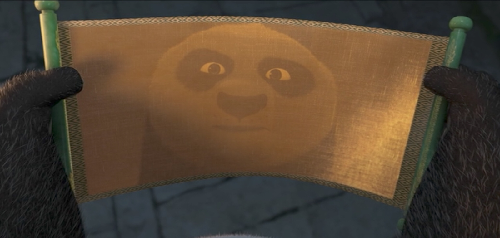

> 

선물시장에서 통하는 매매 기법은 매우 단순하다.

- 차트 패턴
- 눌림목
- 지지/저항에서 나타나는 캔들 패턴
- 가격의 중요한 이평선 관통

위에 열거한 사항들이 매매에서 99%.
뭐 대단한 필살기가 있을까 싶어서 여기저기 뒤져봐야 증시 생긴 이래로 이것 외엔 없다.

계속해서 연습해서 장중에서 나타나는 매매 신호를 놓치지 않는 것과
정확한 타이밍에 들어가고 나오는 것을 연습해서 숙달하는 것 외에 성공할 다른 방법은 없다.
