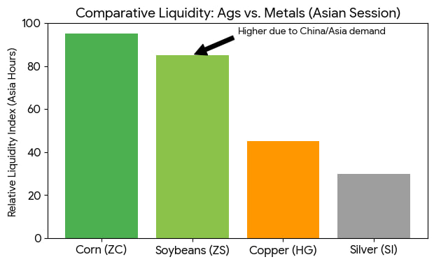

#### 대두 복합체(Soybean Complex) 수급 구조 및 크러시 스프레드 상세 분석

본 보고서는 시카고상품거래소(CME) 및 실물 시장 데이터(2026년 기준)를 바탕으로 대두 복합체의 물리적 공정, 통계적 상관관계, 실물 지배 구조, 장중 거래 세션 및 가격 제한폭을 유기적으로 결합한 전문 트레이더용 심화 매뉴얼이다.

---

#### 1. 대두 복합체 물리적 생산 비중 (The Yields)

대두 1부셸(약 60파운드)을 가공(Crushing)했을 때 산출되는 가 가치 사슬(Value Chain)의 결과물은 물리적으로 고정된 비중을 가진다. 이는 스프레드 매매 시 계약 수 조절 및 종목별 가중치 설정의 절대적인 기준이 된다.

*   **대두박 (ZM): 약 44~48파운드 산출 (중량 기준 약 75~80%)**
    - 가공물 중 절대적인 무게 비중을 차지하며, 대두 복합체 전체 가공 마진의 구조적 하방과 펀더멘털을 지탱하는 거대한 몸통.
*   **대두유 (ZL): 약 11~11.5파운드 산출 (중량 기준 약 18~20%)**
    - 산출 중량은 적으나 단위당 가격 변동성이 극심하여 가공 마진 전체의 알파 수익 및 추진력(Kicker) 역할을 수행.
*   **잔여물 (Hulls/Waste): 약 1~3파운드 (비금융 자산)**

---

#### 2. 종목 간 상관관계 분석 (Correlation Matrix)

장중(Intraday) 및 추세 거래 시 가격 엇박자를 방지하고 알고리즘 동조화 매매를 수행하기 위한 자산 간 상관계수(60일 통상 기준).

| 종목 쌍 | 상관계수 범위 | 시장 메커니즘 및 트레이딩 시사점 |
| :--- | :---: | :--- |
| **ZS(대두) - ZM(대두박)** | `0.85 ~ 0.95` | **매우 강한 동조화.** 원재료와 주산물의 관계로 추세가 거의 일치함. 농산물 본연의 수급 이슈 반영. |
| **ZS(대두) - ZL(대두유)** | `0.65 ~ 0.75` | **양의 상관관계.** 전체적인 궤적은 동행하나, 국제 유가(WTI)나 에너지 정책에 따라 독자 노선을 걷기도 함. |
| **ZM(대두박) - ZL(대두유)** | `-0.20 ~ 0.30` | **매우 낮은 상관성(시소 게임).** 한정된 원재료 파이의 마진 배분 문제로 인해 장중 반대 방향으로 힘겨루기가 빈번함. |

---

#### 3. 크러시 스프레드 및 오일 쉐어 정밀 산식

서로 다른 거래 단위(부셸, 숏톤, 파운드)를 센트/부셸 단위로 통일하여 가공 업자(Crusher)의 실시간 마진과 상대 가치를 계산하는 공식.

#### ① 보드 크러시 (Board Crush) 산식
> **Crush Margin ($/bu) = (ZM 가격 × 0.022) + (ZL 가격 × 0.11) - (ZS 가격 ÷ 100)**
> *   *상수 유도:* ZM 계수 `0.022` (44파운드 ÷ 2,000파운드), ZL 계수 `0.11` (11파운드 ÷ 100)
> *   *해석:* 결과값이 (+)이면 가공 수익 발생, (-)이면 가공 손실 상태를 의미.

#### ② 오일 쉐어 (Oil Share) 지표
전체 대두 가공 가치 중 대두유(ZL)가 기여하는 비중을 나타내며, 보통 `30~45%` 범위 내에서 박스권을 형성한다.
> **Oil Share (%) = (ZL 가격 × 11) / [(ZM 가격 × 0.022) + (ZL 가격 × 11)] × 100**
> *   *활용:* 바이오 연료 정책 등으로 오일 쉐어가 역사적 고점(45% 이상)에 도달하면 ZM(대두박)의 상대적 저평가(오일 쉐어 매도 / ZM 매수 + ZL 매도) 기회로 포착 가능.

---

#### 4. 실물 시장의 '보이지 않는 손'과 구조적 한계

금융 자산과 달리 농산물 선물은 만기 시 **실물 인도(Physical Delivery)**가 가능하므로, 헤지펀드의 단순 차트 교란(Manipulation)이 극도로 어렵고 실물 지배력을 가진 주체들이 시장의 방향을 통제한다.

*   **글로벌 공급 및 수요 독과점:** 공급측면에서는 미국(27~28%)과 브라질(40~42%) 상위 2개국이 세계 수출의 80%를 장악하며, 수요측면에서는 **중국 한 나라가 전 세계 물동량의 60% 이상을 수입**한다.
*   **ABCD + C 카르텔:** 전 세계 곡물 유통량의 70~90%를 장악한 레거시 4대 메이저 기업(ADM, Bunge, Cargill, Louis Dreyfus)과 중국 국영 자본인 COFCO(중량그룹)가 실제 현물 프리미엄(Basis)과 공장 가동률(Crushing Rate)을 조절하며 공급의 수도꼭지를 통제한다.
*   **용도별 종속성:** ZM은 전 세계 돼지 사육 두수의 50%를 차지하는 중국의 사료 수요(단백질원)와 직결되며, ZL은 미국/브라질 내 생산량의 45~75%가 바이오 디젤(연료)로 태워지므로 국제 유가(WTI) 흐름에 종속적인 선행성을 보인다.

---

#### 5. 선물 시장 운영 특징 및 가격 제한폭 (Daily Price Limit)

식량 안보 및 증거금 부도(Margin Call) 위험을 방지하기 위해 농산물 선물 시장은 독특한 일일 브레이크 타임과 엄격한 가격 제한폭인 **리밋 업/다운(Limit Up/Down)** 장치를 운영한다.

*   **2026년 기준 주요 품목별 일일 가격 제한폭 (Daily Price Limit)**

| 상품명 | 종목 코드 | 기본 제한폭 (Daily Limit) | 확장 제한폭 (Expanded Limit) |
| :--- | :---: | :---: | :---: |
| **대두** | ZS | `$0.70` (70센트) | `$1.05` |
| **대두박** | ZM | `$20.00` | `$30.00` |
| **대두유** | ZL | `$0.035` (3.5센트) | `$0.055` |

*   *확장 제한폭 적용 법칙:* 당일 거래가 기본 제한폭에서 마감(Locked Limit)될 경우, 거래소는 익일 제한폭을 확장 단계로 넓혀 에너지를 분출시킨 후 안정 시 기본 제한폭으로 회복시킨다. 팔려는 사람만 존재하여 하한가에 갇히는 Locked Limit 상태는 트레이더가 직면하는 가장 치명적인 청산 리스크다.

---

#### 6. 실전 장중 트레이딩 시간대별 핵심 전략 (뉴욕 시간 ET 기준)

명확한 장 오픈 경계가 사라진 23시간 전자 거래(CME Globex) 체제 하에서 거래량과 변동성이 극대화되는 3대 핵심 유동성 윈도우이다.

1.  **08:00 ~ 10:00 (글로벌 메인 윈도우 - 최대 거래량):** 뉴욕 증시(본장) 개장 직전의 HFT 알고리즘 가동, **오전 08:30 미국 주요 거시경제 지표(CPI, 고용 등) 발표**, 그리고 유럽(런던) 증시의 마감 세션 물량이 중첩되는 골든 아워입니다. 가장 촘촘한 호가창이 형성되므로 대형 포지션 진입 및 돌파 매매의 정석 구간이다.

2.  **21:00 ~ 23:30 / 01:30 ~ 03:00 (상하이 거래소 연동 세션):** 중국의 거대한 실물 수요를 대변하는 상하이황금거래소(SGE) 및 상하이선물거래소(SHFE)의 오전장/오후장 개장 시간대이다. 야간 세션임에도 아시아발 실물 수급과 DCE 대두박 가격 변화에 동조하여 CME 대두 복합체 차트가 선행 변동성을 형성한다.

> 
> 
<em>차트 1. 아시아 시간대 주요 원자재 상대적 유동성 비교 (출처: DTN)</em>

3.  **17:00 (일일 거래 마감 및 정산 시간):** 당일 거래가 마감되고 일일 정산가(Settlement Price)가 확정되는 시점이다. 직전 15~20분 동안 가공업자들의 포지션 오프셋 및 롤오버 물량으로 인해 알고리즘 괴리 현상과 예측 불가능한 변동성이 일시적으로 폭발하므로 무리한 추격은 지양해야 한다.
